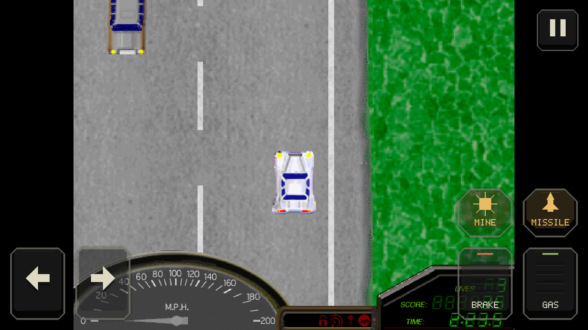

# Reckless Drivin' — Desktop, Android and WebAssembly Ports

> An SDL2 port of the classic Mac OS 9 racing game **Reckless Drivin'** by Jonas Echterhoff, for Linux, macOS, Windows, Android, and the web.

**Android APK:** [Download the latest release](https://github.com/LachlanBWWright/RecklessDrivinPort/releases/latest)

**Desktop builds:** [Build workflow artifacts](https://github.com/LachlanBWWright/RecklessDrivinPort/actions/workflows/build.yml)

Linux, macOS, and Windows packages are built on pushes and pull requests, or by
running the Build workflow manually. Download the artifact for your platform,
then extract the archive inside it:

- Linux: `reckless-drivin-linux.tar.gz`, containing the executable and game data.
- macOS: `reckless-drivin-macos.tar.gz`, containing the application bundle and SDL2.
- Windows: `reckless-drivin-windows.zip`, containing the executable, game data,
  SDL2, and required Microsoft runtime files.

Desktop builds run the same game code and Lua scripts as the browser version.
The Angular level editor remains a web application. Linux requires the SDL2
and GTK3 runtimes; macOS bundles are ad-hoc signed, without Developer ID signing or notarization. See the
[desktop build instructions](dev-readme.md#native-desktop-builds) for local builds.

On Linux, macOS, Windows and Android, the original **Register** button opens a
native customisations dialog. Choose launch options and add custom `resources.dat`
files to a saved dropdown library. Imported files are copied into app storage;
applying settings restarts the game. The browser version keeps its existing
customisation controls below the game.

**Play online:** [https://lachlanbwwright.github.io/RecklessDrivinPort/](https://lachlanbwwright.github.io/RecklessDrivinPort/)

Captured from the Android 14 emulator in the [Android CI workflow](https://github.com/LachlanBWWright/RecklessDrivinPort/actions/workflows/android.yml).

## Troubleshooting

**"WASM bundle missing" in the game panel** — you haven't built the WASM bundle yet. See the [developer notes](dev-readme.md).
The level editor still works without it.

**"Failed to load resources" / 404 on resources.dat** — you ran `pnpm exec ng serve` directly
instead of `pnpm start`. Always use `pnpm start` so the `prestart` hook copies the assets.

**Spinner in level editor never goes away** — open DevTools → Console and look for worker
errors. The most common cause is opening the page from a `file://` URL; always use the dev
server (`pnpm start`).

**cmake / emcmake not found** — activate the Emscripten SDK first:
`source /path/to/emsdk/emsdk_env.sh`

## Acknowledgements

Original game by **Jonas Echterhoff** — source code at https://github.com/jechter/RecklessDrivin.
This fan-made port builds on earlier work by Nathan Craddock
(https://github.com/natecraddock/open-reckless-drivin) and uses Pomme by Jorio
(https://github.com/jorio/Pomme). Research and documentation by Nathan Craddock.
